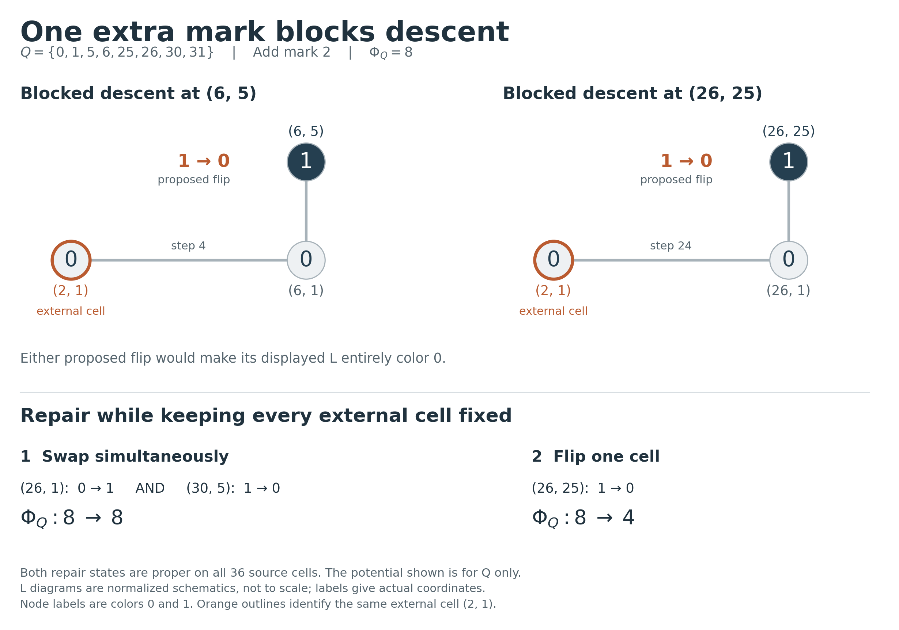

# 三维块的外部阻塞：单格陷阱、成组修复与边界预算

2026-11-06。基于 `d6755b48f1fb6e786cc9b480b0d40139f3da2140` 的[三维源九步平衡结果](../three_cube_forcing/README.md)，研究完整三维块嵌入更大源后的约束。本文所有势函数变化均指 **块内 Φ_Q**，不表示全源势函数下降。

- **COUNTEREXAMPLE / FINITE-CHECKED**：只给八点源增加标记 2，就存在合法着色，使固定外部颜色后的所有不增势内部单格路径都无法到达平衡；完整 36 格证书及可达闭包已核验。
- **FINITE-CHECKED**：同一外部着色下仍有平衡解，先同时交换两格、再翻转一格即可达到；最小内部 Hamming 修复距离为 3。
- **PROVED**：一般嵌入三维块的内部候选改色可按相关边界角计费，给出纯解析不等式 `Φ_Q≤4+8(B_Q^I+|J_Q|)`。
- **FINITE-CHECKED + 结构转移**：对全部 258,228 个内部正常着色，两个独立实现核对完整候选数分布，可将上述系数 8 加强为 6。该加强使用穷尽计算；没有宣称其纯解析证明。

这些结果不推出 G9、S21 或新的 R₃ 数值界，也不宣称文献优先权或完成 Lean 形式化。



## 1. 一个外部标记即可阻止内部下降

取

```math
Q=\{0,1,5,6,25,26,30,31\},\qquad A=Q\cup\{2\}.
```

下表在每行 v 中，按 `u∈A,u<v` 升序给出颜色，完整覆盖 `V(A)` 的 36 格。

| v | 陷阱着色 | 同边界的平衡着色 |
|---:|:---|:---|
| 1 | `0` | `0` |
| 2 | `10` | `10` |
| 5 | `000` | `000` |
| 6 | `1011` | `1011` |
| 25 | `00000` | `00000` |
| 26 | `101011` | `111010` |
| 30 | `1001111` | `1000111` |
| 31 | `00101011` | `00101011` |

二者均不含单色 L。`V(A)` 共 33 个角，其中 24 个完全在 Q 内、9 个为新增角。左侧 `Φ_Q=8`，右侧 `Φ_Q=4`；含新标记 2 的八个外部格颜色完全相同。

必须区分“翻转能降低势”与“在 Q 内合法且能降低势”。左侧有三个纯势函数下降候选，但只有两个在 Q 内合法：

| 候选格 | ΔΦ_Q | 在 Q 内合法？ | 翻转后的阻塞角 |
|---|---:|:---:|---|
| `(6,5)` | −4 | 是 | `(2,1),(6,1),(6,5)`，外部角 |
| `(26,25)` | −4 | 是 | `(2,1),(26,1),(26,25)`，外部角 |
| `(31,30)` | −4 | 否 | `(1,0),(31,0),(31,30)`，内部角；另有一个外部阻塞角 |

前两行的当前颜色都是 `(0,0,1)`，翻转最后一格会形成单色 L。它们共用外部格 `(2,1)`，但属于两个不同的外部角。因此不能把“阻塞角数”直接替换成“外部格数”。

## 2. 平台单格移动也不能逃出，但成组改色可以

固定全部外部格，只允许全源正常、且不增加 Φ_Q 的内部单格翻转。从左侧着色出发，穷尽可达闭包恰有 **8 个状态**，每个状态仍为 `Φ_Q=8`。这排除了先在等势平台上移动、再单格下降的修复方式。

这八态恰好由三个自由格 `(25,6),(30,1),(31,0)` 任意翻转得到。每一态的全部合法不增势单格邻居也只来自这三个格，因此闭包是一个三维 Boolean cube；它没有通向平衡着色的下降出口。

同边界平衡解并未被排除。以下两步保持全源正常且边界不变：

1. **同时**将 `(26,1):0→1` 和 `(30,5):1→0`，势保持 `8→8`。
2. 将 `(26,25):1→0`，势从 `8→4`。

“同时”是对着色状态的成组替换，不能把它当成已核验的两次顺序单格操作。对所有 28 种单格改变、378 种双格改变的穷尽检查表明，同边界平衡解至少需要改变三格；上表给出三格见证，所以最小 Hamming 距离恰为 3。核验器并不宣称穷尽了全部三格解。

如果允许调整边界，另一个修复方式是把外部格 `(2,1):0→1`：这个改色本身合法，Φ_Q 不变，随后 `(6,5)` 和 `(26,25)` 都成为全源合法的下降选择。

本反例否定的是固定边界下的“不增势单格路径总能修复”命题；它不否定任意成组修复，也不证明所有边界都存在平衡延拓。

## 3. 一般边界覆盖不等式

设 Q 是任意正的 2-dissociated 三权重的完整子集和源，`Q⊆A`，c 是 `V(A)` 上的正常二染色。沿用前一记录，Φ_Q 只按 `V(Q)` 内的差值纤维计算。

- `I_Q(c)`：翻转后在 Q 内仍正常、且严格降低 Φ_Q 的内部格集合。
- `J_Q(c)⊆I_Q(c)`：其中翻转后在整个 A 上仍正常的格集合。
- 边界角：与 `V(Q)` 相交，但不完全包含在 `V(Q)` 的实际 L；它可以含一个或两个内部格。
- `B_Q^I(c)`：唯一少数色格属于 I_Q 的边界角数。若只要求少数色格属于 `V(Q)`，相应计数记为 B_Q，故 `B_Q^I≤B_Q`。

**覆盖引理（PROVED）。**

```math
|I_Q|-|J_Q|\le B_Q^I\le B_Q.
```

证明：在正常二色三格角中，翻转一格产生单色角，当且仅当翻转的是原来的唯一少数色格。每个 `p∈I_Q\J_Q` 至少被一个边界角阻止；为每个 p 选择一个这样的角。一个角只有一个少数色格，所以这一选择是单射，得到不等式。

## 4. 内部失衡如何按边界角计费

令 a 为不平衡四格纤维数，b 为同色双格纤维数。正常性排除四格纤维全同色，故不平衡只能是 `3+1`。于是

```math
k=\frac{\Phi_Q-4}{4}=a+b,\qquad 0\le a\le3,\quad0\le b\le6.
```

**解析候选下界（PROVED）。**

```math
|I_Q|\ge a+\max(0,2b-2a)\ge\frac{k}{2}.
```

证明：前一轮的四格修复论证在每条失衡原始纤维中提供至少一个内部安全下降格，总计至少 a 个。每条同色双格纤维提供两个势下降候选。这些格作为输入时，翻转会把本纤维唯一的输入对变为混色，始终安全；因此内部阻塞只能来自其完成格角色。

异号二坐标支撑的格不可能充当内部完成格，不能被内部阻止。对同号支撑，平衡原始纤维也不能阻止同色双格的候选：如果强迫其中一格，平衡会通过另一对输入强迫其伙伴取相反色，与两格同色矛盾。

剩下的阻碍只能来自失衡原始纤维。其三个多数色格对应共有位正方形上的三个顶点；它们的三对同色输入中恰有两条方形边、一条对角线。只有边对应的完成格具有二坐标支撑，对角线的完成格具有三坐标支撑。因此每条失衡原始纤维至多阻止两个双格候选，总计至多 2a 个。与 a 个四格候选相加得第一式。若 `b≤a`，a 本身至少为 `(a+b)/2`；若 `b≥a`，`2b−a≥(a+b)/2`，得第二式。

结合覆盖引理得到完全解析的边界预算：

```math
\Phi_Q\le4+8\bigl(B_Q^I+|J_Q|\bigr).
```

特别地，如果没有任何内部下降在全源中存活，即 `J_Q=∅`，则 `Φ_Q≤4+8B_Q^I`。

## 5. 穷尽计算加强系数与精确阈值

两个独立枚举器完整核对代表 Q 的全部 258,228 个正常二染色，得到下表。枚举所有着色，不除去换色对称，也不只检查某一条下降路径。

| k | 0 | 1 | 2 | 3 | 4 | 5 | 6 | 7 | 8 | 9 |
|---|---:|---:|---:|---:|---:|---:|---:|---:|---:|---:|
| 精确最小 `|I_Q|` | 0 | 2 | 3 | 3 | 4 | 4 | 4 | 6 | 8 | 10 |

每个最小值的完整着色见证，以及 `(k,|I_Q|)` 的全部联合分布均已保存。两个实现采用不同角生成方式及变量顺序，完整联合分布一致。前一轮已证明全部正的 2-dissociated 三维源具有同构的角约束及纤维划分，所以该有限证书适用于整个这一源族。

由表可得计算辅助的加强：

```math
|I_Q|\ge\frac23k,\qquad
\Phi_Q\le4+6\bigl(B_Q^I+|J_Q|\bigr).
```

候选数的比例系数 `2/3` 在 `k=6,|I_Q|=4` 取等。取 `A=Q`，便有 `B_Q^I=0,J_Q=I_Q`，所以含 `B_Q^I+|J_Q|` 的一般预算也在 `Φ_Q=28` 取等。**这不证明完全阻塞 `J_Q=∅` 时纯边界式 `Φ_Q≤4+6B_Q^I` 中的系数 6 最优**：后者还需实际外部阻塞见证。

精确表也给出更直接的判断：若 B_Q^I 小于所在 k 的表项，至少有一个内部下降步骤在整个源中仍合法。特别是，一个相关边界角不足以完全阻止任何非平衡块的下降。

第 1 节反例有 `k=1,|I_Q|=2,|J_Q|=0,B_Q^I=2,B_Q=3`，恰用两个相关边界角阻断全部内部安全候选。这验证了 k=1 时的最小阻塞角阈值；它不意味着每一种两角边界都能造成陷阱。

## 6. 新增单标记的候选范围

任意角可写为 `(a,u),(v,u),(v,b)`，其中 `u<a,b<v` 且 `a+b=u+v`。对 `A=Q∪{t}`，新角必在这四个标记位置中使用 t。

若 t 出现一次，移项得到 `t∈Q+Q−Q`；允许其余标记重复。若 t 出现两次，只可能是内部的 `a=b=t`，得到 `2t=u+v`。因此所有可能产生新角的整数 t 都包含在有限候选集

```math
\left((Q+Q-Q)\cup\left(\frac{Q+Q}{2}\cap\mathbb Z\right)\right)\setminus Q.
```

中点项不能漏掉。该公式一般先给出必要候选集，还需检查严格区间条件。对本例 Q，候选集恰有 62 个整数，范围从 −31 到 62；逐一直接枚举发现每个确实产生 1–9 个新角，表格记录在 `budget_results.json`。

新角在 t 为外端点或重复中点时含一个内部格；t 为唯一内部标记时含两个内部格。这是边界预算必须同时允许一格、两格交叠的原因。

## 7. 核验、范围与后续问题

从仓库根目录运行，数学核验全部只需 Python 标准库：

```sh
python3 research/three_cube_boundary/verify_witness.py
python3 research/three_cube_boundary/independent_budget.py
python3 research/three_cube_boundary/verify_budget.py --independent-report research/three_cube_boundary/independent_budget_results.json
```

图像另需 Matplotlib：`python3 research/three_cube_boundary/render.py`。

- `witness.json`：完整陷阱、同边界平衡着色和修复步骤。
- `witness_results.json`：全角核验、全部八个不增可达状态、最小修复距离及外部解锁证书。
- `budget_results.json`：完整候选计数、所有极值见证、边界预算检查及 62 个新增标记的几何计数。
- `independent_budget_results.json`：独立枚举输出，用于整张联合分布的交叉核验。

各报告绑定输入和核验器 SHA-256；检查不会被 `python -O` 跳过。研究基线及原主稿有限核验不等于对本记录作了 Lean 形式化。

本轮将下一步收窄为：**在冻结外部颜色且确有平衡延拓时，是否总存在允许至多两格同时翻转的不增势修复路径？** 本例对此给出正面见证，但尚未证明这一一般命题。另一个全局障碍是不同三维块会重复使用同一边界角；缺少重数控制时，局部预算不能直接求和为全局源界。

**后续更新（2026-11-06）：该双格猜想已被否定。** [双格修复反例与精确八格阈值](../three_cube_pair_repair/README.md)给出同一标记集上的另一个边界着色，以六格不变量证明双格不增势路径失败；对该新实例的完整有限核验进一步排除允许升势的七格路径，并给出四格、八格两步修复。前文的具体单格陷阱及边界预算不受影响。
