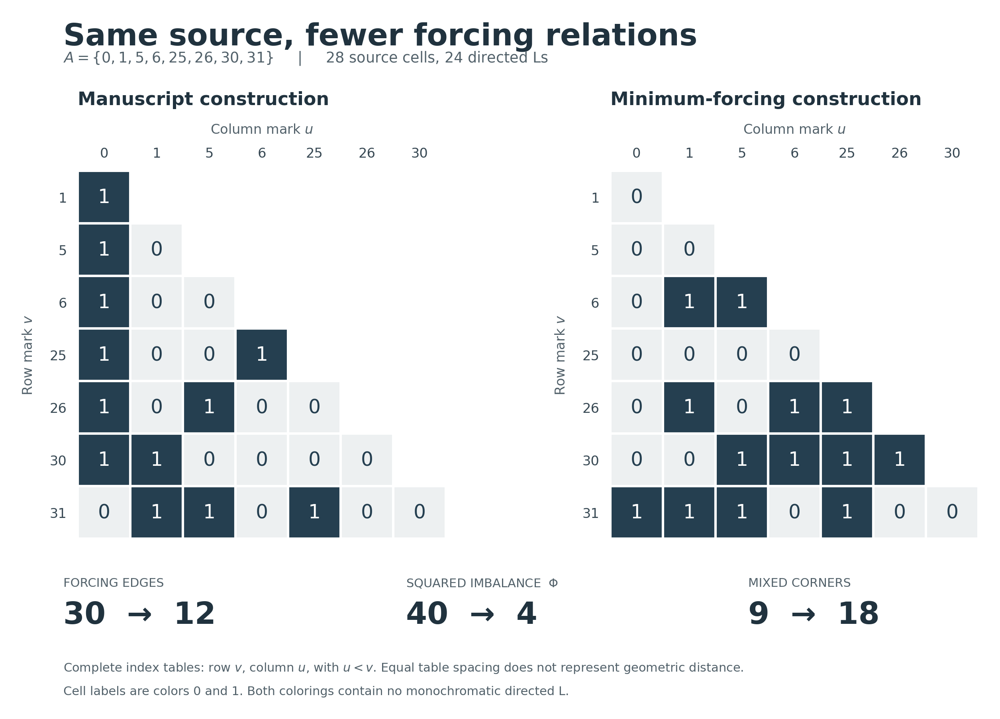

# 三维立方体源：最少强迫边与九步平衡

2026-11-06。独立研究记录；主数学稿未修改。

**PROVED**：对任意正的 2-dissociated 三权重，正常二染色严格源的最少强迫角为 6，最少强迫边为 12。任何正常二染色均可用至多 9 次合法单格翻转达到最优；每次翻转恰好减少一条强迫角、两条强迫边。

**FINITE-CHECKED**：代表源的全部 258,228 个正常二染色已由 Python 和独立 C++ 程序完整枚举，其中 16,640 个达到最优。本记录不推出全体整数源的 G9、S21 或新的 Ramsey 数值界；未审计文献优先权，也未完成 Lean 形式化。



## 1. 对象与记号

三个正整数权重满足 2-dissociation，含义是

```math
\sum_{i=1}^3 a_iw_i=0,\quad a_i\in\{-2,-1,0,1,2\}
\quad\Longrightarrow\quad a_1=a_2=a_3=0.
```

令 `q_S=Σ_{i∈S}w_i`，`Q={q_S:S⊆[3]}`，`V(Q)={(v,u):u<v, u,v∈Q}`。整体平移不影响结论。一个格子也可标记为无序子集对 `{S,T}`，物理方向由两个子集和的大小决定。正常着色 `c:V(Q)→{0,1}` 不含正步长单色 L。

差值纤维由 `v−u=d` 的格子组成。记 `z(p)=1−2c(p)`，`s_d=Σ_{p∈F_d}z(p)`，`Φ=Σ_d s_d²`。H 是平行输入同色的强迫角数，B 是输入异色的混色角数，Γ 是正文的物理强迫图。

由正文 `prop:counts`、`thm:forcing` 的精确恒等式：

```math
M=28,\quad T=24,\quad H+B=T,\qquad
H=\frac{2T-M+\Phi}{4}=5+\frac{\Phi}{4},\qquad |E(\Gamma)|=2H.
```

| 着色 | Φ | 强迫角 H | 混色角 B | 强迫边数 |
|---|---:|---:|---:|---:|
| 正文三维立方体构造 | 40 | 15 | 9 | 30 |
| 本记录的平衡构造 | 4 | 6 | 18 | 12 |

正文构造实现混色角最少，本记录研究强迫角最少。两个极值目标不同，原来的九混色角定理仍然成立。

## 2. 最优值及统一构造的证明

2-dissociation 保证两个数值差相等，当且仅当它们的有符号坐标支撑相等。支撑大小为 t 的差值有 `2^(3−t)` 个表示：支撑外的坐标可作为两个端点共有的位。因此有三条四格纤维、六条双格纤维、四条单格纤维。

四条单格纤维对 Φ 各贡献 1，其余项非负，所以所有着色都有 `Φ≥4`，正常着色满足 `H≥6`、`|E(Γ)|≥12`。

对不同子集 S,T 定义颜色规则：

```math
c(\{S,T\})=|S\cap T|\pmod 2,
\qquad\text{但规定 }c(\{\varnothing,[3]\})=1.
```

例外格位于单格纤维，不影响重复纤维的平衡。验证全部角如下：

1. 固定原始差值 `w_i`，另两个坐标记为 j,k。四格的共有位 `∅,{j},{k},{j,k}` 对应颜色 `0,1,1,0`。六对输入中四对异色。两个 0 格完成于 `{∅,[3]}`，颜色为 1；两个 1 格完成于互补的单点／双点子集对，交集为空，颜色为 0。无论 `w_j<w_k` 或相反，六个角均正常。
2. 支撑大小为二的差值，其两个表示的共有位是 `∅` 和剩余的单坐标，颜色分别为 0、1，因此唯一的角正常。
3. 支撑大小为三的纤维只有一格，不产生角。

这些情况覆盖全部 24 个角。所有重复纤维均平衡，故 `Φ=4`，达到上述下界，完成最优性证明。

代表权重 `(1,5,25)` 给出 `Q={0,1,5,6,25,26,30,31}`。第 v 行按 `u∈Q,u<v` 升序排列，完整着色为：

| v | 颜色行词 |
|---:|:---|
| 1 | `0` |
| 5 | `00` |
| 6 | `011` |
| 25 | `0000` |
| 26 | `01011` |
| 30 | `001111` |
| 31 | `1110100` |

## 3. 九步平衡定理的解析证明

### 哪些格子能够充当完成格

若 `(v,u)` 是一个角的完成格，则存在严格位于 u,v 之间的标记 x,t，满足 `x+t=u+v`。2-dissociation 将数值等式转为逐坐标的子集标签等式。因此：

- 支撑大小为一的格子不能作为完成格：没有另一对允许的内部标签。
- 异号二坐标支撑的格子也不能作为完成格。端点是 `q_R+w_i,q_R+w_j`；唯一另一对数值是 `q_R,q_R+w_i+w_j`，分别在区间两侧。
- 同号二坐标支撑的格子，只能由对应两个原始差值纤维完成。端点是 `q_R,q_R+w_i+w_j`；内部点只能是 `q_R+w_i,q_R+w_j`。

### 第一步：平衡三条四格纤维

固定差值 `w_i`，其四个起点为 `0,w_j,w_k,w_j+w_k`。四格不能全同色：否则六对输入的完成格全为相反色，其中以下三个完成格构成步长 `w_k` 的单色 L：

```math
(w_i+w_j,0),\quad
(w_i+w_j+w_k,0),\quad
(w_i+w_j+w_k,w_k).
```

所以颜色分布只能为 `2+2` 或 `3+1`。对 `3+1` 纤维，考虑翻转一个多数色格。它不能作为完成格；它与另外两个多数色格的输入对在翻转后变成混色。唯一可能产生冲突的是它与少数色格的输入对。

如果三个多数格的翻转全被阻止，则这三对混色输入的完成格都必须为少数色。原来的三对多数色输入也已经把各自完成格强迫为少数色。六个完成格全为少数色，再次出现上式的单色 L，矛盾。

因此至少有一个多数格能安全翻转，把该纤维变成 `2+2`。一次翻转只改变该格所在纤维的颜色数，至多三次即可平衡全部原始纤维。

### 第二步：平衡六条双格纤维

只需处理两个格子同色 c 的纤维。

异号支撑的两个格子均不能作为完成格。任选一格翻转，只会把本纤维唯一的同色输入对改成混色，因此安全。

同号支撑的两个格子是 `q₀=(w_i+w_j,0)`、`q₁=(w_i+w_j+w_k,w_k)`。如果 q₀ 被某个原始纤维的一对同色输入强迫，该输入对颜色必为 `1−c`。这个原始纤维已平衡，所以平移 `w_k` 后的另两格必同为 c，进而强迫 q₁ 取 `1−c`，与 q₀,q₁ 同色矛盾。从 q₁ 出发论证相同。因此两格都没有同色输入对强迫它；任选一格翻转都安全。

再用至多六次翻转，所有重复纤维平衡，达到 `Φ=4`。

### 每步下降量与局部极小

翻转格 p 只改变它所在纤维的和：

```math
\Delta\Phi=(s_d-2z(p))^2-s_d^2=4(1-z(p)s_d).
```

上述每步都把绝对不平衡为 2 的纤维变成平衡，因此 `ΔΦ=−4`、`ΔH=−1`、`Δ|E(Γ)|=−2`。不平衡的重复纤维至多九条，得到九步界。

同时，任何非最优正常着色都存在合法严格下降单格翻转：若有不平衡四格纤维，用第一步；否则用第二步。选择任意合法严格下降步骤均会终止于最优，不存在非最优单格下降局部极小。

关键机制是：四格纤维的全面阻塞会制造单色 L；原始纤维平衡后，双格纤维的阻塞又与伙伴同色矛盾。这是本源族内部的修复规则。

## 4. 全枚举与改色证书

Python 通过同差值输入对生成约束，并另行检查直接几何编码；C++ 独立按物理步长 h 枚举 L。两者采用不同变量次序，只有已完整赋色的单色角才剪枝，完整覆盖 `2^28` 种可能赋值，不除去全局换色对称。

| Φ | 合法着色数 |
|---:|---:|
| 4 | 16,640 |
| 8 | 53,760 |
| 12 | 74,944 |
| 16 | 60,672 |
| 20 | 32,880 |
| 24 | 13,280 |
| 28 | 4,436 |
| 32 | 1,296 |
| 36 | 288 |
| 40 | 32 |

总计 258,228。无合法严格下降邻居的状态恰好是全部 16,640 个最优状态。Python 还记录了全部 1,218,456 条有向严格下降单格移动，其 `ΔΦ` 均为 −4。两程序对总数、分布、局部极小分布、状态整数和及异或一致；和与异或只是辅助对照，不是密码学摘要。

从正文着色出发，按格子索引选择第一个合法下降步骤，实际得到：

| 步骤 | 翻转格 `(v,u)` | 翻转后的 Φ | 强迫边 |
|---:|:---:|---:|---:|
| 0 | 初始 | 40 | 30 |
| 1 | `(5,1)` | 36 | 28 |
| 2 | `(6,0)` | 32 | 26 |
| 3 | `(6,1)` | 28 | 24 |
| 4 | `(6,5)` | 24 | 22 |
| 5 | `(25,1)` | 20 | 20 |
| 6 | `(25,5)` | 16 | 18 |
| 7 | `(26,0)` | 12 | 16 |
| 8 | `(26,1)` | 8 | 14 |
| 9 | `(30,0)` | 4 | 12 |

贪心路径可与证明中“先四格、再双格”的次序不同。每一步已直接核验正常；终点不要求等于第 2 节的符号构造，因为最优着色不唯一。全部中间行词保存在 `results.json`。

初始时直接翻转 `(6,1)` 会把 `(5,0),(6,0),(6,1)` 变成单色角；先做前两步后，该翻转变得合法。这展示了约束如何随其他格子的改色解除。

## 5. 枚举计数在三维源族内的转移

按权重升序重新标记。全部 24 个角的子集标签形式与权重数值无关：

- 18 个原始差值角：四起点顺序为 `∅,{j},{k},{j,k}`，只依赖 `w_j<w_k`。
- 3 个同号二坐标支撑角：输入是 `{∅,{i,j}}`、`{{k},[3]}`，完成格是 `{∅,[3]}`。
- 3 个异号二坐标支撑角：若 `w_i>w_j`，输入是 `{{j},{i}}`、`{{j,k},{i,k}}`，完成格是 `{{j},{i,k}}`。

三坐标支撑不产生角，纤维划分只依赖同一有符号支撑。因此约束超图、Φ 和合法单格翻转同构，计数可转移到整个正的 2-dissociated 三维源族；无需假定最大权重大于另两者之和。

程序另核对了权重至多 15 的全部 1,146 个有序 2-dissociated 三元组。一般结论依靠上述同构论证，不依靠这批有限测试。

## 6. 限制与下一步

规则不能原样延伸到四维。若只把空集／四元全集格改为 1，则对任意不同 i,j,k，以下三格全为 0：

```math
(w_i,0),\quad(w_i+w_j+w_k,0),\quad(w_i+w_j+w_k,w_j+w_k).
```

它们是步长 `w_j+w_k` 的单色 L。中间格对应空集／三元子集，不是唯一例外格。这只否定此规则的直接延伸，不否定四维源可二染色。

下一步应检查：**三维块嵌入更大源后，块外角怎样阻止本来合法的九步修复？** 本证明中的“原始差值格不能作为完成格”针对完整三维源内部；额外标记可能产生新的完成约束。若要得到全局源界，须控制这些外部阻碍和不同块之间的重复计数。

## 7. 复现

从仓库根目录运行，Python 核验只用标准库，C++ 使用 C++17：

本次实际环境：Python 3.14.0；Apple clang 21.0.0 (`clang-2100.3.34.2`)，arm64。研究起点为提交 `080822bb1d434b164a1f42ea159d0bf148396b71`。两套程序交叉核验通过，主稿 13 项有限核验通过。

```sh
clang++ -O3 -std=c++17 -Wall -Wextra -pedantic research/three_cube_forcing/independent_enumeration.cpp -o /tmp/three_cube_check
/tmp/three_cube_check --output research/three_cube_forcing/independent_results.json
python3 research/three_cube_forcing/verify.py --independent-report research/three_cube_forcing/independent_results.json
python3 manuscript/verify_directed_L_manuscript.py --source manuscript/main.tex --bib manuscript/references.bib --output research/three_cube_forcing/manuscript_verification.json
```

图像脚本另需 Matplotlib：`python3 research/three_cube_forcing/render.py`。

`results.json` 含完整构造、全部角、逐步改色、代码摘要和运行信息；`independent_results.json` 为第二实现输出；`manuscript_verification.json` 记录原主稿的 13 项有限核验。它们不替代解析证明。
