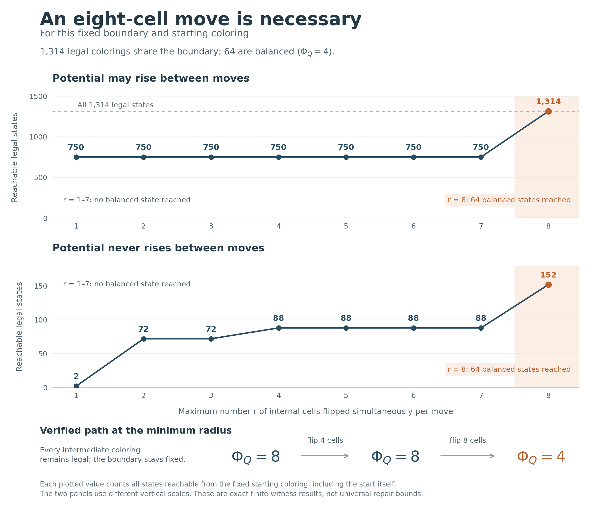

# 固定边界下的修复障碍：双格猜想的反例与精确八格阈值

2026-11-06。接续[外部阻塞与边界预算](../three_cube_boundary/README.md)中提出的问题：若固定外部颜色后仍存在平衡延拓，是否总能通过每步至多两格、势函数不增的内部改色达到平衡？**答案是否定的，即使只增加一个外部标记。**

- **COUNTEREXAMPLE / PROVED**：给出完整着色及六格不变量，解析证明上述双格不增势路径不可能存在；起点和同边界平衡延拓的合法性另由有限证书逐角核验。
- **FINITE-CHECKED**：对这个固定边界和起点，允许势函数暂时上升也无济于事：每步至多改变七格的合法路径都不能到达平衡。
- **FINITE-CHECKED**：一次四格、随后一次八格的改色即可平衡，势为 `8→8→4`。所以这个实例的最小允许单步块大小恰为 **8**，无论是否要求不增势。

这里的 8 是一个实例的精确阈值，**不是任意边界的通用修复上界**。本文不改进 R₃ 的数值界，不证明 G9 或 S21，不宣称文献优先权或完成 Lean 形式化。



## 1. 定义与完整证书

取正的 2-dissociated 权重 `1,5,25`，以及

```math
Q=\{0,1,5,6,25,26,30,31\},\qquad A=Q\cup\{2\}.
```

源格为 `V(A)={(v,u):u<v, u,v∈A}`。正常二染色指没有单色正向 L，即不存在同色的 `(x,y),(x+h,y),(x+h,y+h)`，其中 `h>0`。共有 36 个源格和 33 个 L。内部指 28 格 `V(Q)`；其余八格的颜色在整个路径上固定。

按内部差值纤维定义势函数：

```math
\Phi_Q(c)=\sum_{d>0}\left(\sum_{\substack{u,v\in Q\\v-u=d}}(1-2c(v,u))\right)^2.
```

内部共有三个四格纤维、六个双格纤维和四个单格纤维，因此 `Φ_Q≥4`；等号当且仅当所有非单格纤维均为两色数量相等。下文“平衡”均指 `Φ_Q=4`，不涉及全源势函数。

下表每行 v 的字符串按 `u∈A,u<v` 升序排列。三列分别是陷阱、修复中间态和平衡终态，完整覆盖所有 36 格。

| v | 陷阱 c₀ | 中间态 c₁ | 平衡态 c₂ |
|---:|:---|:---|:---|
| 1 | `0` | `0` | `0` |
| 2 | `11` | `11` | `11` |
| 5 | `110` | `010` | `010` |
| 6 | `1011` | `1011` | `1011` |
| 25 | `11010` | `01010` | `00010` |
| 26 | `100001` | `100001` | `110000` |
| 30 | `0001110` | `0001110` | `1100110` |
| 31 | `11000000` | `11001010` | `10001011` |
| Φ_Q | 8 | 8 | 4 |

三列共享外部颜色：

```text
(2,0)=1,  (2,1)=1,  (5,2)=0,  (6,2)=1,
(25,2)=0, (26,2)=0, (30,2)=0, (31,2)=0.
```

这与前一记录的单格陷阱使用不同的外部着色，不能把两个证书混为一例。`witness.json` 保存 c₀ 和 c₂；`verification_results.json` 保存全部合法状态、c₁ 及逐步路径。

## 2. 双格不增势修复失败的人工证明

固定上述边界。角 `((1,0),(2,0),(2,1))` 强制 `X=(1,0)=0`；角 `((26,2),(30,2),(30,6))` 强制 `Y=(30,6)=1`。

在 c₀ 中，记六个内部格及其颜色为

```text
P=(25,1)=1, R=(26,1)=0, S=(26,25)=1,
U=(31,30)=0, V=(31,1)=1, W=(30,1)=0.
```

差值 24 的纤维恰为 `{P,Y}`，颜色为 `1,1`，贡献势 4；四个单格纤维另贡献 4。由于 `Φ_Q(c₀)=8`，其余非单格纤维都平衡。

以下是任何拟议的正常终态都必须满足的颜色蕴含，不假设同一步中的翻转有先后顺序：

| 颜色变化的依赖 | 所用正向 L | 固定颜色 |
|:---|:---|:---|
| `P=0 ⇒ R=1` | `(25,1),(26,1),(26,2)` | `(26,2)=0` |
| `R=1 ⇒ S=0` | `(2,1),(26,1),(26,25)` | `(2,1)=1` |
| `U=1 ⇒ V=0` | `(2,1),(31,1),(31,30)` | `(2,1)=1` |
| `V=0 ⇒ W=1` | `(30,1),(31,1),(31,2)` | `(31,2)=0` |
| `W=1 ⇒ P=0` | `(25,1),(30,1),(30,6)` | `Y=1` |

**不变量。** 从 c₀ 出发，每一步至多同时翻转两格、保持全源正常且不增加 Φ_Q 的任何路径，都保持这六格的颜色及 `Φ_Q=8`。

证明用归纳。设当前六格颜色如上且 `Φ_Q=8`。P 若变为 0，前两条蕴含同时要求 R、S 改色，至少需要三格，因此 P 不变。Y 被边界固定，所以差值 24 纤维继续贡献 4，下一态势至少为 8；不增势条件迫使其仍为 8，其余非单格纤维也必须全部保持平衡。

于是，一个平衡纤维内若有格改色，必须在同一纤维中另有补偿改色。接下来逐项排除：

- R 若改变，则 S 也必须改变；二者分别在差值 25、1 的不同平衡纤维中，剩余改色额度不足以补偿。
- U 若改变，则 V 也必须改变；二者分别在差值 1、30 的不同平衡纤维中，同样不能补偿。
- V 若改变，则 W 也必须改变；V 在平衡的差值 30 纤维，W 在差值 29 的单格纤维，V 得不到补偿。
- W 若改变，则 P 必须改变，而 P 已被排除。
- S 所在的差值 1 纤维是 `{X,(6,5),S,U}`。平衡及 `X=0,S=1,U=0` 迫使 `(6,5)=1`；要把 S 从 1 改为 0，必须把 X 或 U 从 0 改为 1，二者均已被排除。

故六格保持不变，归纳完成。任何平衡态都必须使 `{P,Y}` 两色各一格，因 Y 固定为 1，必有 P=0，与不变量矛盾。表中的 c₂ 又确实给出同边界平衡延拓，故“双格不增势修复总能成功”被否定。

本证明独立于后面的 72 态可达闭包。它本身不确定七格障碍或精确八格阈值，也不适用于允许升势的路径；那些结论使用下一节的完整有限核验。

## 3. 完整状态图与精确八格阈值

独立 Python 核验器固定上述八个外部颜色，穷尽全部 28 个内部变量的正常赋值，得到 **1,314 个合法状态，其中 64 个平衡态**。完整势分布如下：

| Φ_Q | 4 | 8 | 12 | 16 | 20 | 24 | 28 |
|---|---:|---:|---:|---:|---:|---:|---:|
| 状态数 | 64 | 232 | 436 | 384 | 164 | 32 | 2 |

给定 r，两个状态在一次移动中相邻，当且仅当它们在至多 r 个内部格上不同；整个边界始终不变。分别计算不增势的有向可达闭包，以及允许升势的无向连通分量。所有计数都包括起点 c₀。

| 每步最多改变 r 格 | 1 | 2 | 3 | 4 | 5 | 6 | 7 | 8 |
|---|---:|---:|---:|---:|---:|---:|---:|---:|
| 不增势可达状态数 | 2 | 72 | 72 | 88 | 88 | 88 | 88 | 152 |
| 其中平衡态数 | 0 | 0 | 0 | 0 | 0 | 0 | 0 | 64 |
| 允许升势可达状态数 | 750 | 750 | 750 | 750 | 750 | 750 | 750 | 1,314 |
| 其中平衡态数 | 0 | 0 | 0 | 0 | 0 | 0 | 0 | 64 |

**分割证书。** 令 C 为允许至多双格改色、允许升势时 c₀ 的 750 态连通分量。C 没有平衡态，其补集有 564 态。对全部 `750×564=423,000` 对跨集合状态计算内部 Hamming 距离，最小值恰为 8；两个集合的完整状态表和一对取等见证均随报告保存。因此每步至多七格的任何合法路径都不能离开 C，即使势暂时增大，也不可能到达平衡。

上表给出阈值 8 的完整闭包；更短的存在证书是第 1 节的两步路径：

1. c₀→c₁：同时翻转 `(5,0),(25,0),(31,6),(31,26)` 四格，`Φ_Q:8→8`。
2. c₁→c₂：同时翻转 `(25,1),(26,1),(26,25),(30,0),(30,1),(30,5),(31,1),(31,30)` 八格，`Φ_Q:8→4`。

每个端点均逐角验证全源正常，且两步都不增势。因此允许升势与不允许升势两种问题的最小单步块大小都恰为 8。这里“同时翻转”指直接替换状态，不能将其当成已验证的顺序单格路径。

另一个不同的量是从 c₀ 到任意平衡态的**直接 Hamming 距离**，其最小值为 12，c₂ 取到。它不等于路径上最大单步大小：此处可以先改变四格，再改变另外八格。半径 8 下这条两步路径也是步数最短的，因为不存在一步可达的平衡态。

## 4. 发现、独立核验与复现范围

`search.cpp` 使用 C++17，枚举 Q 的全部 258,228 个正常着色，并同时传播新增标记 2 对应的 256 种外部赋值；在双格不增势图上从平衡态反向搜索。报告记录 2,341,440 个全源正常着色；256 种边界均有正常延拓，其中 240 种有平衡延拓；有平衡延拓的组中，13,280 个起点无法用双格不增势路径修复。**这些全 256 组总数来自该 C++ 实现；本目录的独立 Python 完整枚举只覆盖本文选中的边界组，不宣称对上述总数作了独立复算。**

`verify.py` 不使用 C++ 的合法状态列表或闭包作为搜索输入。它从 `witness.json` 的几何和固定颜色重新枚举，采用两种角生成方式核对约束，直接比较全部合法状态对的 Hamming 距离，再计算逐半径闭包和分割证书。`crosscheck.py` 将两实现重叠范围内的计数、起点及完整 72 态闭包交叉核对。核验失败会抛出异常，不依赖可被 `python -O` 关闭的断言。

从仓库根目录运行：

```sh
# 独立数学核验：Python 3.10+ 标准库
python3 research/three_cube_pair_repair/verify.py

# 发现程序：C++17；只把可复现源码和 JSON 报告入库
clang++ -O3 -std=c++17 -Wall -Wextra -pedantic research/three_cube_pair_repair/search.cpp -o /tmp/cube_pair_search
/tmp/cube_pair_search --mark 2 --output research/three_cube_pair_repair/search_results.json
python3 research/three_cube_pair_repair/crosscheck.py

# 图表另需 Matplotlib，直接读取核验报告
python3 research/three_cube_pair_repair/render.py
```

`discovered_witness.json` 保留发现阶段选出的另一个同边界平衡态；`witness.json` 的终态改用上面的两步修复终点。二者均合法，但不要求字符串相同。独立核验报告保存核验器及见证输入 SHA-256，交叉报告绑定当前两份报告和源码的哈希；交叉核验本身不重新运行 C++ 全边界搜索。运行时间与时间戳可能随复现改变。

## 5. 对下一步路线的影响

固定边界的小步修复并不是可靠的局部拼接机制：这个实例甚至排除了七格以内、任意升势的内部路径。下一步应研究哪些边界改色能够连接这些分量，以及这种改色能否同时兼容相邻三维块；只把双格规则扩大到三格并不能解决已展示的障碍。

本文没有排除更大的成组修复、允许改变边界的修复，或带附加结构假设的修复定理。局部状态图的分离也不能直接转化为全局 Ramsey 数值界。
